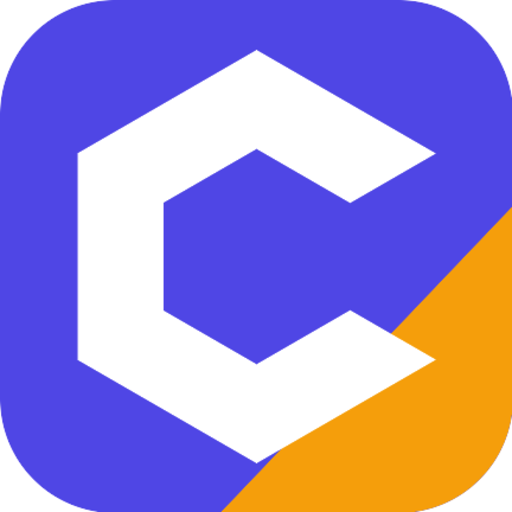

<p align="center">
  
</p>

# Omnicost MCP server

Construction unit prices with source and date for Spain, the US and the EU, available to AI agents over the Model Context Protocol.

Omnicost is a construction cost catalog and estimating tool. It gathers unit prices for materials, labor and equipment from 208 sources such as public tenders and supplier catalogs, and keeps the source and observed date on every price. The catalog holds about 81,000 priced items, and coverage is strongest in Spain, the United States and the European Union. This repository holds the public listing for the hosted MCP server: its `server.json` for MCP registries and ready-to-use client configs.

The server itself is hosted by Omnicost. There is nothing to install or run from this repo.

| | |
| --- | --- |
| Endpoint | `https://omnicost.com/api/mcp` |
| Transport | Streamable HTTP |
| Auth | `Authorization: Bearer <organization API key>` |
| Registry name | `com.omnicost/catalog` |
| Website | https://omnicost.com |

## Get an API key

To connect, create a free Omnicost workspace and generate an organization API key. The Free plan includes one.

1. Sign up at https://omnicost.com/en and create your workspace.
2. Open https://omnicost.com/dashboard/mcp and create an organization API key.
3. Add it to your MCP client config as shown below.

Requests to `/api/mcp` without a key get a `401` that asks for an organization API key from an Omnicost workspace.

## Tools

| Tool | What it does |
| --- | --- |
| `search_catalog` | Semantic search over the catalog. Takes a free-text query (`q`), an optional `limit` (up to 25) and an optional `region`. Returns matching items with median price and vendor count. |
| `get_item` | Fetches one item (`ci_...` id) with its vendor breakdown and recent prices, each with its source. |
| `list_categories` | Lists the top-level catalog categories. |
| `get_decomposition` | Returns the BC3 recipe for an item: the material, labor and machinery components per unit. |

For useful results, query items priced in Spain, the US or the EU.

## Client setup

Replace the placeholder with your organization API key. Keep the key out of version control.

### Cursor

`~/.cursor/mcp.json` or `.cursor/mcp.json` in your project ([examples/cursor.mcp.json](examples/cursor.mcp.json)):

```json
{
  "mcpServers": {
    "omnicost": {
      "url": "https://omnicost.com/api/mcp",
      "headers": {
        "Authorization": "Bearer ${env:OMNICOST_API_KEY}"
      }
    }
  }
}
```

### VS Code

`.vscode/mcp.json` ([examples/vscode.mcp.json](examples/vscode.mcp.json)). VS Code asks for the key the first time and stores it for you:

```json
{
  "inputs": [
    {
      "type": "promptString",
      "id": "omnicost-key",
      "description": "Omnicost API key",
      "password": true
    }
  ],
  "servers": {
    "omnicost": {
      "type": "http",
      "url": "https://omnicost.com/api/mcp",
      "headers": {
        "Authorization": "Bearer ${input:omnicost-key}"
      }
    }
  }
}
```

### Claude Desktop

Claude Desktop talks to remote servers through [`mcp-remote`](https://www.npmjs.com/package/mcp-remote), so you need Node.js installed. Add this to `claude_desktop_config.json` ([examples/claude-desktop.json](examples/claude-desktop.json)):

```json
{
  "mcpServers": {
    "omnicost": {
      "command": "npx",
      "args": [
        "-y",
        "mcp-remote",
        "https://omnicost.com/api/mcp",
        "--header",
        "Authorization:Bearer ${OMNICOST_API_KEY}"
      ],
      "env": {
        "OMNICOST_API_KEY": "<your key>"
      }
    }
  }
}
```

### Any other client

Point a client that supports streamable HTTP at `https://omnicost.com/api/mcp` and send the key as a Bearer token in the `Authorization` header.

## Pricing

The Free plan includes an organization API key for MCP. Omnicost Pro ($9/week, $29/month or $290/year) includes API and MCP access with 100,000 requests a month. See https://omnicost.com/en/pricing.

## More

- REST API docs: https://omnicost.com/en/docs/api
- Developer page: https://omnicost.com/en/developers
- Server card: https://omnicost.com/.well-known/mcp.json
- Support: support@omnicost.com

## License

The contents of this repository are released under the [MIT License](LICENSE). Omnicost is a product of Ipita LLC.
