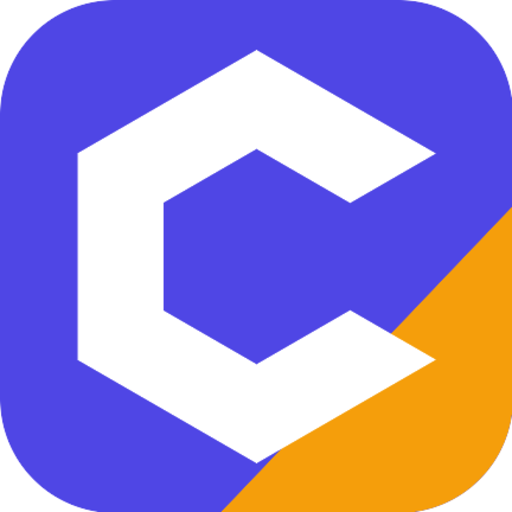

<p align="center">
  
</p>

# Omnicost MCP server

Construction unit prices with source and date for Spain, the US and the EU, available to AI agents over the Model Context Protocol.

Omnicost is a construction cost catalog and estimating tool. It gathers unit prices for materials, labor and equipment from 208 sources such as public tenders and supplier catalogs, and keeps the source and observed date on every price. The catalog holds about 81,000 priced items, and coverage is strongest in Spain, the United States and the European Union. This repository holds the public listing for the hosted MCP server: its `server.json` for MCP registries and ready-to-use client configs.

The server itself is hosted by Omnicost. There is nothing to install or run from this repo.

| | |
| --- | --- |
| Endpoint | `https://omnicost.com/api/mcp` |
| Transport | Streamable HTTP |
| Auth | Sign in with your Omnicost account (OAuth 2.1 + PKCE), or `Authorization: Bearer <API key>` |
| Registry name | `com.omnicost/catalog` |
| Website | https://omnicost.com |

## Connect with your Omnicost account

Claude, ChatGPT and Claude Code can connect by signing in. You need a free Omnicost account; no API key to copy.

- **Claude (claude.ai and Claude Desktop):** Settings → Connectors → Add custom connector. Paste `https://omnicost.com/api/mcp` and click Connect.
- **ChatGPT:** Settings → Apps & Connectors, turn on developer mode and create a connector with the URL `https://omnicost.com/api/mcp` and OAuth authentication.
- **Claude Code:** `claude mcp add --transport http omnicost https://omnicost.com/api/mcp`, then run `/mcp` and pick `omnicost` to sign in.

The client opens an Omnicost sign-in page. Sign in (or create an account), pick the workspace to connect and approve read-only catalog access. The connection uses that workspace's plan: Omnicost Pro limits on Pro, otherwise the free tier (200 requests a minute, 10,000 a month). Access tokens last 1 hour and refresh on their own for 30 days.

Any other client that supports MCP authorization can do the same: every request to `/api/mcp` without a key or token gets a `401` with `WWW-Authenticate: Bearer realm="omnicost", error="missing_token", resource_metadata="https://omnicost.com/.well-known/oauth-protected-resource"`, and the authorization server supports dynamic client registration and Client ID Metadata Documents.

## Connect with an API key

For clients without OAuth, or for scripts:

1. Sign up at https://omnicost.com/en and create your workspace.
2. Open https://omnicost.com/dashboard/mcp and create an organization API key.
3. Add it to your MCP client config as shown below.

## Pay per call without an account (x402)

Agents that pay per call instead of signing in use a separate endpoint, `https://omnicost.com/api/mcp/x402`. There, `initialize`, `tools/list` and `ping` are free, and each `tools/call` costs $0.01 in USDC on Base via [x402](https://omnicost.com/.well-known/x402), charged only when the call succeeds. On `https://omnicost.com/api/mcp`, a request without a key or token gets the `401` that starts sign-in.

## Tools

| Tool | What it does |
| --- | --- |
| `search_catalog` | Semantic search over the catalog. Takes a free-text query (`q`), an optional `limit` (up to 25) and an optional `region`. Returns matching items with median price and vendor count. |
| `get_item` | Fetches one item (`ci_...` id) with its vendor breakdown and recent prices, each with its source. |
| `list_categories` | Lists the top-level catalog categories. |
| `get_decomposition` | Returns the BC3 recipe for an item: the material, labor and machinery components per unit. |

For useful results, query items priced in Spain, the US or the EU.

## Client setup with an API key

Replace the placeholder with your organization API key. Keep the key out of version control. Clients that support OAuth can skip the key; see above.

### Cursor

`~/.cursor/mcp.json` or `.cursor/mcp.json` in your project ([examples/cursor.mcp.json](examples/cursor.mcp.json)):

```json
{
  "mcpServers": {
    "omnicost": {
      "url": "https://omnicost.com/api/mcp",
      "headers": {
        "Authorization": "Bearer ${env:OMNICOST_API_KEY}"
      }
    }
  }
}
```

### VS Code

`.vscode/mcp.json` ([examples/vscode.mcp.json](examples/vscode.mcp.json)). VS Code asks for the key the first time and stores it for you:

```json
{
  "inputs": [
    {
      "type": "promptString",
      "id": "omnicost-key",
      "description": "Omnicost API key",
      "password": true
    }
  ],
  "servers": {
    "omnicost": {
      "type": "http",
      "url": "https://omnicost.com/api/mcp",
      "headers": {
        "Authorization": "Bearer ${input:omnicost-key}"
      }
    }
  }
}
```

### Claude Desktop

Claude Desktop talks to remote servers through [`mcp-remote`](https://www.npmjs.com/package/mcp-remote), so you need Node.js installed. Add this to `claude_desktop_config.json` ([examples/claude-desktop.json](examples/claude-desktop.json)):

```json
{
  "mcpServers": {
    "omnicost": {
      "command": "npx",
      "args": [
        "-y",
        "mcp-remote",
        "https://omnicost.com/api/mcp",
        "--header",
        "Authorization:Bearer ${OMNICOST_API_KEY}"
      ],
      "env": {
        "OMNICOST_API_KEY": "<your key>"
      }
    }
  }
}
```

### Any other client

Point a client that supports streamable HTTP at `https://omnicost.com/api/mcp`. Either let it sign in with OAuth or send the key as a Bearer token in the `Authorization` header.

## Pricing

A free account can connect by OAuth or with an organization API key. Omnicost Pro ($9/week, $29/month or $290/year) includes API and MCP access with 100,000 requests a month. See https://omnicost.com/en/pricing.

## More

- REST API docs: https://omnicost.com/en/docs/api
- Developer page: https://omnicost.com/en/developers
- Server card: https://omnicost.com/.well-known/mcp.json
- Auth for agents: https://omnicost.com/auth.md
- Support: support@omnicost.com

## License

The contents of this repository are released under the [MIT License](LICENSE). Omnicost is a product of Ipita LLC.
